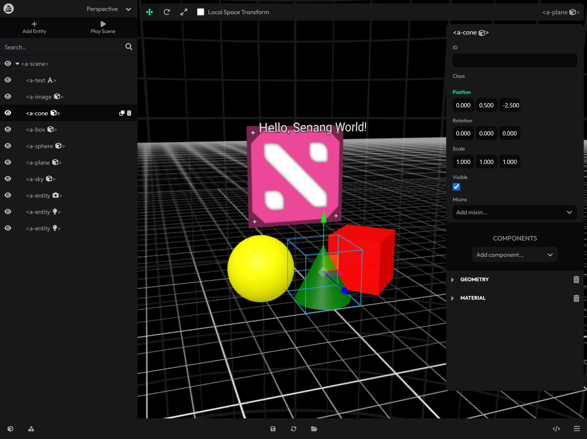

# SenangWebs A-Frame Editor

A visual scene editor for [A-Frame](https://aframe.io), also branded **SenangWebs Webverse** in the interface. Build and refine 3D scenes in the browser with a scene tree, transform gizmos, component properties, and a texture library. This project adapts [A-Frame Inspector](https://github.com/aframevr/aframe-inspector) for the SenangWebs ecosystem.



## Features

- **Scene hierarchy:** search by ID, tag, class, or CSS selector; expand and collapse entities; drag to reorder or reparent; toggle visibility; duplicate and delete.
- **Entity creation:** add boxes, spheres, cylinders, cones, toruses, planes, images, text, lights, and empty entities from the primitive picker.
- **Visual transforms:** translate, rotate, and scale with viewport gizmos or numeric properties; switch between world and local transform space.
- **Component editing:** edit entity IDs, visibility, transforms, and mixins; add and remove registered A-Frame components and edit their schema-based properties.
- **Viewport tools:** perspective and six orthographic views, selection focusing, grid visibility, camera and light helpers, scene playback, and preview mode.
- **Textures:** choose existing scene images, browse a searchable texture library, or load an image URL with a preview before adding it to the scene.
- **Persistence:** explicitly save and restore browser drafts, download editable scene HTML, and see unsaved-change feedback.
- **Host integration:** control the editor through `AFRAME.INSPECTOR`, including transaction-based undo and redo.

## Run locally

Use Node.js and npm. The repository's CI uses Node.js 20.

```bash
git clone https://github.com/a-hakim/senangwebs-aframe-editor.git
cd senangwebs-aframe-editor
npm install
npm start
```

Open [http://localhost:3333/examples/](http://localhost:3333/examples/). The example loads the local editor bundle and opens the editor automatically. The development server serves the repository on port `3333`.

The included example uses A-Frame `1.7.0`. A-Frame must load before the editor: the bundle uses the page's global `AFRAME` and `THREE` and edits the first scene in `AFRAME.scenes`.

## Add the editor to a scene

### Open automatically

Build the editor with `npm run dist`, then serve the complete `dist/` directory alongside your site. Load the editor script after your scene, as in [the example](./examples/index.html):

```html
<!doctype html>
<html>
  <head>
    <meta charset="utf-8" />
    <title>My A-Frame scene</title>
    <script src="https://cdn.jsdelivr.net/gh/aframevr/aframe@1.7.0/dist/aframe-master.min.js"></script>
  </head>
  <body>
    <a-scene>
      <a-box id="box" position="0 1 -3" color="#0088ff"></a-box>
      <a-sky color="#ececec"></a-sky>
    </a-scene>

    <!-- Replace this path with your hosted editor directory. -->
    <script src="/editor/dist/sw-webverse.min.js"></script>
  </body>
</html>
```

Serve the page over HTTP or HTTPS so scripts, assets, and the texture catalog can load.

### Open on demand

Set A-Frame's `inspector` component to your hosted bundle, then press **Ctrl+Alt+I** to load it:

```html
<a-scene inspector="url: /editor/dist/sw-webverse.min.js">
  <!-- Your scene entities. -->
</a-scene>
```

During local development, use `http://localhost:3333/dist/sw-webverse.js` as the inspector URL. Choose either on-demand loading or a direct script tag for a page.

**Deploy all JavaScript files in `dist/` together.** The glTF exporter loads a sibling chunk on demand, with its URL resolved relative to the editor script.

## Editing workflow

1. Select an entity in the viewport or scene tree to open its properties. Double-click a tree entry or press **F** to focus the camera on it.
2. Use **Add Entity** to choose a primitive. Edit its position, rotation, scale, material, and other components in the properties panel.
3. Drag the transform gizmo to move, rotate, or resize the selection. Use the camera dropdown to inspect it from another view.
4. Organize entities in the scene tree. Drop near a row's top or bottom to reorder, or in its center to nest under that entity.
5. Use **Play Scene / Pause Scene** to control playback while editing. The headset button switches to scene preview and returns to the editor; **Ctrl+Alt+I** also toggles modes.
6. Save a browser draft or download the scene HTML to keep your work.

Drag with the left mouse button to orbit, the right button to pan, and the middle button to zoom. The mouse wheel also zooms.

Press **0** to toggle the panels. Selecting an entity opens its properties; the **+** button reopens the hidden scene tree. On narrow windows, the tree and properties share the available space and appear one at a time.

### Saving and downloading

Use **Ctrl** on Windows/Linux or **Cmd** on macOS for the save, restore, search, and copy/paste shortcuts below.

| Action | Shortcut | Behavior |
| --- | --- | --- |
| Save draft | Ctrl/Cmd+S | Stores the scene in this browser's `localStorage`, scoped to the page path and scene ID. |
| Restore draft | Ctrl/Cmd+Alt+R | Replaces the current scene with the saved draft; asks for confirmation when there are unsaved edits. |
| Download HTML | Ctrl/Cmd+Shift+S | Downloads an editable scene with script and stylesheet references and a base URL for resolving assets. |

Drafts do not update source files or sync to another device. Saving is explicit, and browser storage can be cleared or unavailable. The status bar reports save results and unsaved changes; leaving the page with unsaved edits triggers a browser warning.

The HTML download retains external dependencies rather than bundling their contents. Keep the original scripts, stylesheets, and assets accessible when reopening it. Downloading leaves the scene marked unsaved because starting a download does not confirm that the file was saved.

### Keyboard reference

Press **H** to open the shortcut dialog. Most scene shortcuts apply while the editor is open and focus is outside a form control or dialog.

| Shortcut | Action |
| --- | --- |
| W / E / R | Translate / rotate / scale |
| O | Toggle world/local transform space |
| F | Focus selected entity |
| G | Toggle grid |
| N | Add an empty entity |
| D | Duplicate selected entity |
| Delete / Backspace | Delete selected entity |
| Ctrl/Cmd+C, Ctrl/Cmd+V | Copy and paste an entity within the editor |
| Ctrl/Cmd+F | Focus scene-tree search |
| 0 | Toggle panels |
| 1 | Perspective view |
| 2 / 3 | Left / right view |
| 4 / 5 | Top / bottom view |
| 6 / 7 | Back / front view |
| Escape | Clear selection; close an open dialog |
| H | Open shortcut help |
| Ctrl+Alt+I | Toggle editor and scene preview |

In the scene tree, **Up/Down**, **Home**, and **End** move selection; **Left/Right** collapse or expand entries. Dialogs support **Tab**, **Shift+Tab**, and **Escape**.

## Configure the texture library

The default texture library reads `https://aframe.io/sample-assets/dist/images.json`. Existing images in the scene's `<a-assets>` remain available in the texture picker. Remote images must allow cross-origin loading.

Set these globals **before loading the editor** to customize the library.

### Host the sample assets yourself

Copy or clone [A-Frame sample-assets](https://github.com/aframevr/sample-assets) to your server, preserving its catalog and image directories, then set the root URL with a trailing slash:

```html
<script>
  window.AFRAME_SAMPLE_ASSETS_ROOT = '/sample-assets/';
</script>
```

The loader requests `dist/images.json` beneath that root and resolves image and thumbnail paths from the catalog.

### Supply a custom collection

Set `COLLECTION_ASSETS_ROOT` to the URL of a JSON collection. It takes precedence over the sample-assets catalog:

```html
<script>
  window.COLLECTION_ASSETS_ROOT = '/textures/collection.json';
</script>
```

The collection is an array. Only `src` is required; `thumbnail` (or `thumb`), `id`, dimensions, and tags are optional:

```json
[
  {
    "id": "brick-wall",
    "src": "/textures/brick-wall.jpg",
    "thumbnail": "/textures/thumbs/brick-wall.jpg",
    "width": 1024,
    "height": 1024,
    "tags": ["brick", "wall"]
  }
]
```

Use absolute or site-root-relative image URLs; collection image paths are used as supplied, without resolving them against the JSON file's location. Images without thumbnails load their full preview when selected.

## Host integration

After initialization, the editor is available as `AFRAME.INSPECTOR`. The internal Inspector naming is retained for compatibility.

```js
const editor = AFRAME.INSPECTOR;
editor.open();
editor.selectEntity(editor.sceneEl.querySelector('#box'));
editor.close(); // Return to scene preview.
editor.toggle();
```

### Undo and redo API

Undo and redo are exposed through the API; the editor does not add undo/redo buttons or keyboard shortcuts.

```js
const editor = AFRAME.INSPECTOR;
if (editor.canUndo()) await editor.undo();
if (editor.canRedo()) await editor.redo();

// Host changes must be explicitly recorded. Nested transactions form one step.
const result = editor.transaction('Update box', () => {
  const box = editor.sceneEl.querySelector('#box');
  box.setAttribute('material', 'color', '#0088ff');
  box.setAttribute('position', '1 2 -3');
  return box.id;
});

const state = editor.getHistoryState();
// { canUndo, canRedo, undoCount, redoCount, undoLabel, redoLabel, busy }
editor.clearHistory(); // Keep the scene; discard history and reset its baseline.
```

`undo()` and `redo()` return `Promise<boolean>`: `true` when replay and editor refresh finish, or `false` if the stack is empty or an operation is active. Replay failures reject, roll back scene changes, and retain the history cursor.

`canUndo()` and `canRedo()` return `false` during transactions, continuous input interactions, and replay. Finish an active input interaction by blurring the field before calling these methods from a host control. `clearHistory()` throws while an operation is active.

`transaction(label, callback)` returns the callback's result, records no-op changes as no step, and restores authored scene state if the callback throws. Callbacks must be synchronous: finish asynchronous preparation before entering a transaction. A returned promise is rejected as an unsupported transaction; later asynchronous side effects cannot be rolled back.

History automatically covers editor properties/transforms, visibility, IDs, mixins, component addition/removal, entity creation/deletion, duplication/paste, hierarchy order and reparenting, and successfully loaded texture assets. Gizmo drags and numeric scrubs each form one step; continuous field edits finish on blur, Enter, or interaction completion. A texture insertion and its material assignment form one step. Cancelled confirmations and failed image loads create no entries. Selection is restored with replayed actions.

The event bus emits `historychanged` with the same state returned by `getHistoryState()` whenever availability, labels, counts, or busy state changes:

```js
editor.events.on('historychanged', (state) => {
  // Update your host application's undo/redo controls.
  console.log(state.canUndo, state.canRedo, state.busy);
});
```

Those subscriptions are removed when the inspector is destroyed. Internal integrations can also subscribe through `src/lib/Events`. Missing labels are `null`; stacks are read-only through this public interface.

History retains the latest **100 committed steps in memory**. A new edit after undo discards redo steps. Opening/closing the inspector preserves history; scene reload and browser draft restore start a new history session. Saving and downloading do not create history entries, and replay marks the scene unsaved.

`editor.history.updates` remains available as the latest authored attribute and component differences from the baseline, keyed by current nonempty entity IDs; removed attributes/components are `null`. IDs should be unique for this legacy export view; undo/redo itself also works with unnamed entities and duplicate IDs.

Host transactions cover authored DOM attributes, component values, assets, text, and hierarchy inside the current scene. Replacing the scene root, arbitrary JavaScript state, event listeners, asset bytes, direct `object3D` writes, and runtime animation are outside the transaction contract. Subtrees recreated by structural replay may have new DOM elements; resolve elements from the current scene after replay instead of retaining references to deleted or moved nodes.

## Development and builds

| Command | Purpose |
| --- | --- |
| `npm start` | Start the development server on port `3333`. |
| `npm run build` | Build `dist/sw-webverse.js` with source maps. |
| `npm run dist:min` | Build `dist/sw-webverse.min.js` in production mode. |
| `npm run dist` | Build both development and minified distributions, including supporting chunks. |
| `npm run lint` | Lint JavaScript in `src/`. |

The bundle filenames come from [webpack.config.js](./webpack.config.js). Load them explicitly in your page; the package's legacy `main` field still points to `dist/aframe-inspector.min.js`.

| Path | Contents |
| --- | --- |
| `src/index.js` | Editor initialization, lifecycle, and public API. |
| `src/components/` | React scene tree, properties, viewport toolbars, widgets, and dialogs. |
| `src/lib/` | Scene editing, viewport controls, history, persistence, assets, shortcuts, and events. |
| `src/style/` | Stylus styles for the editor interface. |
| `examples/` | Example A-Frame scene using the local editor bundle. |
| `dist/` | Browser bundles, supporting chunks, and source maps. |

## Credits and license

SenangWebs A-Frame Editor is a fork of [A-Frame Inspector](https://github.com/aframevr/aframe-inspector), created by the A-Frame authors and contributors. It builds on their visual inspection and scene-editing tools for WebXR.

Released under the [MIT License](./LICENSE), retaining the upstream copyright notice.
